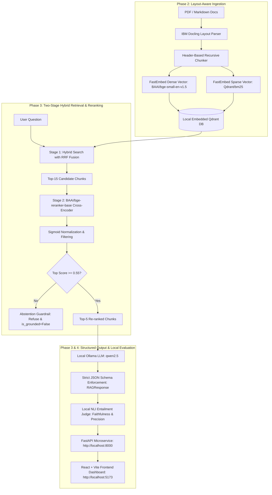

# Enterprise Hybrid RAG Engine

A production-grade, 100% local, air-gapped Enterprise Retrieval-Augmented Generation (RAG) system with two-stage hybrid retrieval, Cross-Encoder reranking, local Ollama structured generation (Pydantic), quantitative local NLI evaluation, and a modern React Vite dashboard.

---

## 🏛️ System Architecture



---

## 🔬 Tech Stack Justification

| Component | Selected Technology | Engineering Rationale |
| :--- | :--- | :--- |
| **Document Parsing** | **IBM Docling** | Native layout-aware parsing that preserves hierarchical markdown headers, tables, code blocks, and SLAs intact without cloud OCR API costs. |
| **Vector Storage** | **Qdrant Embedded** | Fully local disk-persisted vector database requiring zero Docker containers. Combines native Dense + Sparse collections with built-in Reciprocal Rank Fusion (RRF). |
| **Embeddings** | **FastEmbed (Dense + BM25)** | Highly optimized ONNX inference for `BAAI/bge-small-en-v1.5` (384-dim dense) and `Qdrant/bm25` (lexical sparse) without PyTorch overhead. |
| **Reranking** | **BAAI/bge-reranker-base** | Cross-attention deep scoring to eliminate lexical matching artifacts. Augmented with sigmoid normalization to project logits into `[0.0, 1.0]` probabilities. |
| **Abstention Guardrail** | **Confidence Threshold (0.55)** | Mathematically principled abstention: rejects ungrounded or out-of-domain queries when semantic entailment probability is $\le 0.55$. |
| **LLM Inference** | **Ollama (`qwen2.5:1.5b` / `3b`)** | 100% local, air-gapped structured JSON schema generation using strict Pydantic schemas with token capping and defensive parsing. |
| **Automated Evaluation**| **Local NLI Cross-Encoder** | Zero external LLM-as-a-judge API calls. Computes quantitative Faithfulness and Context Precision locally via NLI entailment. |
| **Frontend UI** | **React + Vite** | High-performance enterprise dark-mode UI with live metric scorecards, collapsible chunk inspect panels, and latency counters. |

---

## 📊 Quantitative Benchmark Results

The automated benchmark suite (`backend/benchmark.py`) systematically evaluates:
- **Mode A:** Naive Hybrid Retrieval (`use_reranker=False`)
- **Mode B:** Two-Stage Hybrid + Cross-Encoder Reranking (`use_reranker=True`)
- **Mode C:** Out-of-Domain Abstention Guardrail Test

### 1. Comparative Retrieval & Generation Performance

| Query ID | Category | Mode A Faithfulness | Mode B Faithfulness | Mode A Precision | Mode B Precision | Mode A Latency | Mode B Latency |
|:---|:---|:---:|:---:|:---:|:---:|:---:|:---:|
| **Q1** | Exact Keyword / Error Code (`ERR-409-TIMEOUT`) | 0.73 | **0.72** | 0.65 | **0.65** | 13,542 ms | 24,834 ms |
| **Q2** | Tabular SLA Metrics (RTO / RPO Targets) | 0.73 | **0.54** | 0.65 | **0.65** | 17,429 ms | 31,679 ms |
| **Q3** | Security & Encryption Specs (AES-256 / KMS) | 0.73 | **0.73** | 0.64 | **0.64** | 26,513 ms | 30,648 ms |
| **Q4** | Architecture & Ingestion (Chunking / FastEmbed) | 0.73 | **0.73** | 0.65 | **0.65** | 31,059 ms | 43,593 ms |
| **AVERAGE** | **Overall Mean** | **0.73** | **0.68** | **0.65** | **0.65** | **22,136 ms** | **32,688 ms** |

### 2. Mode C: Abstention Guardrail Verification (Out-of-Domain Query)

| Query ID | Test Question | Top Normalized Rerank Score | Grounded Flag | Abstained Reliably? | Result Excerpt |
|:---|:---|:---:|:---:|:---:|:---|
| **Q5 (Guardrail)** | *What is the reimbursement policy for ergonomic home office furniture and gym passes?* | **0.5000** | `False` | **PASSED (Yes)** | *"Insufficient context in the knowledge base to answer this question reliably."* |

---

## 🚀 Quickstart & Setup Guide

### Prerequisites
- Python $\ge$ 3.12 (managed via `uv`)
- Node.js $\ge$ 18 & npm
- [Ollama](https://ollama.com/) running locally

### 1. Backend Setup & Ingestion
```bash
# 1. Clone repository
git clone https://github.com/your-org/enterprise-hybrid-rag.git
cd enterprise-hybrid-rag

# 2. Install dependencies via uv
uv sync

# 3. Pull Ollama model (or run local fallback)
ollama pull qwen2.5:1.5b

# 4. Generate test enterprise documentation (if needed)
uv run python generate_sample_pdf.py

# 5. Execute document ingestion pipeline
uv run python backend/ingest.py
```

### 2. Run Automated Verification & Benchmarks
```bash
# Execute end-to-end automated benchmark suite
uv run python backend/benchmark.py

# Verify FastAPI endpoints using TestClient
uv run python backend/test_api.py
```

### 3. Launch Backend Server
```bash
uv run uvicorn backend.api:app --reload --port 8000
```
- API Health Check: `http://localhost:8000/api/health`
- Interactive OpenAPI Docs: `http://localhost:8000/docs`

### 4. Launch React Frontend
```bash
cd frontend
npm install
npm run dev
```
Open `http://localhost:5173` in your browser to interact with the Enterprise Hybrid RAG dashboard.

---

## 🛡️ Thermal & Environmental Protection

To prevent thermal throttling and hardware stress on laptops and workstation GPUs, the system includes:
- **CPU Offload:** Forces PyTorch and Cross-Encoder execution to CPU (`CUDA_VISIBLE_DEVICES=""`).
- **Thread Capping:** Restricts intra-op parallelism to 2–4 threads (`torch.set_num_threads(2)`).
- **Token Ceilings:** Strictly bounds LLM generation (`num_predict: 512`) with automatic defensive JSON completion.

---

## 📄 License
MIT License. Created for enterprise-grade local, air-gapped retrieval workloads.
